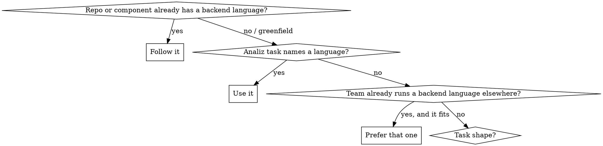

# Backend Language Decision

## Overview

You write Go, Java, C#/.NET, TypeScript on Node.js and Rust. The wrong choice is not a style preference — it fights the grain of the problem and the repository for the life of the code. Decide deliberately, at the start of the task, before writing anything.

**Core principle:** the repository's existing language wins by default. Only a greenfield service, or the analiz task's explicit direction, opens the choice.

## The Decision

How to tell what the repository is: the manifest (`go.mod`, `pom.xml` / `build.gradle(.kts)`, `*.csproj` / `*.sln` / `Directory.Build.props`, `package.json` with a server dependency, `Cargo.toml`) and get_project_brief's stack for your component.

## Task shape, for a greenfield service

| Shape | First choice | Why |
|-------|--------------|-----|
| High-QPS API, streaming, fan-out, background workers, small I/O-bound service | **Go** (Fiber, hexagonal) | simple concurrency, fast builds, small binaries |
| Rich domain: many entities, invariants, business rules, a JVM shop | **Java** (Quarkus first, Spring Boot when Quarkus does not fit) | mature OOP modelling and framework ecosystem |
| Rich domain in a Microsoft or Azure shop, or next to existing .NET services | **C#/.NET** (ASP.NET Core) | the same strengths as Java with the team's own platform |
| Thin API or BFF beside a TypeScript frontend, shared types with the client, a team that writes TypeScript | **TypeScript on Node.js** (Fastify; NestJS for a larger domain) | one language across the product |
| Latency- or memory-critical path, CPU-heavy processing, a component where a crash or a data race is unacceptable | **Rust** (axum on tokio) | predictable performance and memory safety, at a higher cost to write |

When two rows fit, take the one the team already operates — a language nobody else on the board maintains is a cost the task does not pay for.

Then load the stack's own skills: go-hexagonal-architecture and fiber-rest-api; quarkus-service-architecture or spring-boot-fallback; dotnet-aspnetcore-service; node-typescript-service; rust-axum-service — and the matching testing skill.

## Hard Rule

Never introduce a second language into a single-stack repository or component. If a Go repository needs a capability that "would be nicer in Rust", that is a question for the architect's analysis, not a unilateral stack addition — say so in a task comment and build it in the repository's language.

## Common Mistakes

- Picking your favourite language instead of the repository's.
- Rust for a CRUD endpoint with no performance requirement — the borrow checker is a cost, not a feature, there.
- Node.js for a CPU-bound job that will block the event loop.
- Go or TypeScript for a domain with dozens of interacting business rules, then hand-rolling what Java or .NET would have given you.
- Choosing by a benchmark instead of by who will maintain it.

## Red Flags

- You are about to `go mod init`, `dotnet new`, `npm init` or `cargo init` inside a repository whose manifest says another language.
- Your choice has no reason beyond preference.
